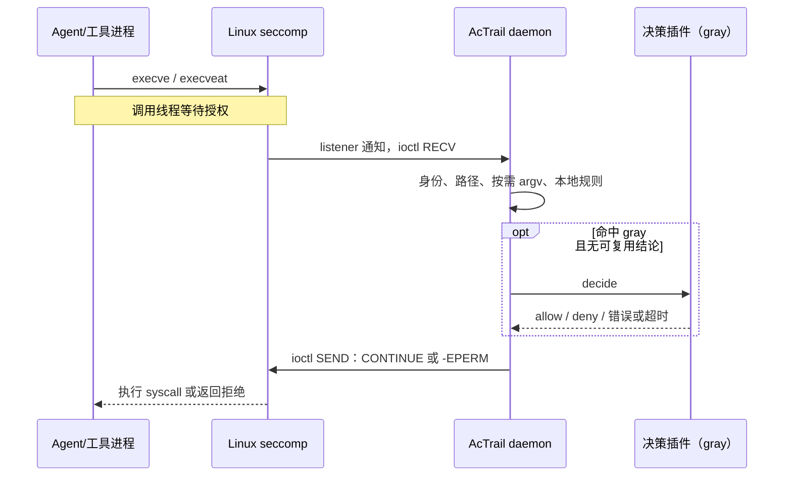

# AcTrail 与 CensorGuard 拦截机制对比

审查日期：2026-10-08。AcTrail 来源为用户指定的公开仓库
<https://gitcode.com/openeuler/AcTrail>；检查的是下载时默认分支 HEAD
`3b4dcdb6480c547724791f1792c482297a737a22`（提交日期 2026-08-27）。
CensorGuard 对象为当前工作区。本文为源码和文档审查，没有加载安全钩子或进行性能实测。

## 1. 客户沟通结论

“CensorGuard 的规则裁决在内核态完成；AcTrail 当前命令、网络和文件控制路径
需要用户态 daemon 裁决并回复内核”有源码依据。

“AcTrail 每次拦截都有毫秒级延迟”没有本次实测依据，不能从用户态往返直接推出。
同样不能据此承诺 CensorGuard 固定纳秒级、微秒级或具体性能倍数。

两者都通过内核机制在操作完成前阻断；AcTrail 并非只能事后审计或杀进程。
准确的差异是规则判定的位置、同步路径依赖和所覆盖的授权点。

建议客户表述：

> 两者都具备事前阻断能力。AcTrail 当前通过 seccomp user notification 和
> fanotify 将待授权操作交给用户态 daemon，先匹配本地规则，灰名单再调用决策插件，
> 最后回复内核。CensorGuard 将已编译规则部署到 eBPF Map，由 LSM 钩子直接查询
> 并返回放行或拒绝，无需逐请求等待用户态裁决。这个结构减少了同步调度、通知传递和
> 用户态排队依赖；具体延迟和吞吐差异需要在同等策略与审计配置下实测。

## 2. AcTrail 的命令阻断流程

1. `actrailctl launch` 创建受控子进程，子进程设置 `PR_SET_NO_NEW_PRIVS`。
2. 在子进程中安装 seccomp filter，通过 `SECCOMP_FILTER_FLAG_NEW_LISTENER`
   获得 listener FD。启用 command control 时将 `execve`、`execveat` 配成
   `SECCOMP_RET_USER_NOTIF`。
3. 子进程安装完成后 `SIGSTOP`。父进程借助 pidfd 复制 listener FD，建立 trace，
   通过 Unix socket 的 `SCM_RIGHTS` 把 FD 交给 daemon 注册，完成后恢复子进程。
4. 工作负载或其继承 seccomp filter 的后代调用目标 syscall，调用线程在内核等待通知响应。
5. daemon 用 `SECCOMP_IOCTL_NOTIF_RECV` 取通知，验证通知有效性、进程身份和 trace，
   读取目标进程中的路径，并在规则需要时读取 argv 快照。
6. daemon 查询本地规则。明确 allow/deny 不调用插件；gray 查询可复用结论，必要时
   交给有并发、容量和超时约束的 worker 调用 control-decider 插件。
7. deny 通过 `SECCOMP_IOCTL_NOTIF_SEND` 返回 `error=-EPERM`；allow 最终通过
   `SECCOMP_USER_NOTIF_FLAG_CONTINUE` 让内核继续原 syscall。

普通 allow 的实现细节：`respond_if_denied()` 只立即回复 deny；allow 可以继续经过
exec 观测等处理，最终由 `NotificationContinuation::finish()` 回复 CONTINUE。
因此完整同步延迟可能包含同一通知链的其他处理。

源码证据（下列相对路径均位于上述 AcTrail 提交）：

| 路径 | 定位 |
|---|---|
| `crates/apps/ctl/src/launch/seccomp.rs` | `install_seccomp_listener()`，约 91 行；安装 filter、NEW_LISTENER |
| `crates/apps/ctl/src/launch/seccomp/rules.rs` | `build_seccomp_rules()`，约 32 行；`append_notify_return()`，约 229 行 |
| `crates/apps/ctl/src/launch/controlled.rs` | `spawn()`、`child_exec()`、`duplicate_child_listener()` |
| `crates/apps/ctl/src/launch.rs` | 约 254 行注册 listener，307 行恢复子进程 |
| `crates/apps/daemon/src/services/seccomp_notify/notify.rs` | 46 行 RECV，62 行 CONTINUE，81 行拒绝响应 |
| `crates/apps/daemon/src/services/command_control/service.rs` | 141 行处理通知，213 行计时，规则查询与 gray 分流，542 行返回拒绝 |
| `crates/apps/daemon/src/services/command_control/decision.rs` | 63 行 `ExecNotificationContext::capture()` |
| `crates/apps/daemon/src/services/seccomp_notify/service.rs` | `NotificationContinuation::finish()`、`drain_listener()` |
| `crates/apps/daemon/src/services/live/seccomp.rs` | 文件、命令、网络、进程观测及 payload 的通知分发链 |

## 3. AcTrail 的网络与文件阻断

网络控制也使用 seccomp user notification，当前控制 `AF_INET/AF_INET6` 的
`connect(2)`。daemon 读取目标进程中的 `sockaddr`，构建身份和 endpoint 上下文，
先查 `SocketAddr` 精确索引，再查 `IpAddr` 全端口索引；无规则走默认决策，
明确 allow/deny 直接回复，gray 按缓存、并发上限、worker、timeout/fallback 处理。
拒绝返回 `EPERM`，允许回复 CONTINUE。

当前网络规则不解析域名，不支持 CIDR，不覆盖 `sendto`、AF_UNIX、已有连接、
未安装 listener 的普通 attach，以及非 `SYS_connect` 的异步 I/O 路径。
这些边界由其 `docs/reference/plugin-api/control-decider.md:358` 明确说明。

文件打开使用 fanotify permission events：

1. daemon 以 `FAN_CLASS_PRE_CONTENT` 创建 fanotify group，对目标目录添加
   `FAN_OPEN_PERM | FAN_EVENT_ON_CHILD` marks。
2. 命中 mark 的打开请求在内核等待权限响应；daemon 读出事件 FD、PID、mask。
3. daemon 判断内置放行、trace 归属和策略匹配；未受控进程放行，本地明确规则直接
   判定，gray 才进入插件路径，支持可复用结论、并发预算和超时 fallback。
4. daemon 向 fanotify FD 写 `fanotify_response`，其值为 `FAN_ALLOW` 或 `FAN_DENY`。

不能把当前文件控制概括成“只有 fanotify”：`mkdir/mkdirat`、`rmdir` 和
`unlinkat(..., AT_REMOVEDIR)` 还可以通过 seccomp notification 处理，文件变更拒绝
返回 `EACCES`。本次检查的 mapping 只包含 mkdir/rmdir 类；不能把观测到的
unlink/rename/write 事件都算作对应的阻断能力。

证据：`services/network_control/service.rs:160`、`network_control/request.rs:25`；
`services/enforcement/fanotify.rs:24,44,115,229`；
`services/enforcement/service/decision.rs:36`；
`services/enforcement/service/seccomp.rs:28`；
`crates/core/linux_platform/src/file_seccomp.rs:6`。

## 4. 与 CensorGuard 的区别

| 维度 | AcTrail 当前实现 | CensorGuard 当前实现 |
|---|---|---|
| 命令授权 | seccomp 通知，daemon 查规则，回复内核 | `lsm/bprm_check_security` 查 Map 并直接返回 |
| 网络授权 | seccomp 的 `SYS_connect` 通知，daemon 判定 | `lsm/socket_connect` 判定 |
| 文件授权 | fanotify open permission；mkdir/rmdir 补充 seccomp | file_open、file_permission、unlink/rename/truncate、mmap 等 LSM 授权点 |
| 明确规则的同步路径 | 仍需用户态往返，不一定调用插件 | 无逐请求用户态裁决 |
| 灰名单复杂决策 | 用户态插件、缓存、并发预算、timeout/fallback | 当前未实现同等的同步 gray 插件裁决 |
| 对既有进程接入 | 普通 attach 不等于安装 seccomp；文件 fanotify 能力另论 | 注册既有 TGID 后，已挂载 LSM 按 Map 判断其后续操作 |
| 后代进程 | seccomp filter 继承，加 eBPF trace membership 维护 | fork 钩子继承 scope，LSM 查当前规则 |
| 动态策略 | 已有动态 file/command/network policy publisher 接口及 revision 管理 | YAML 编译、Map bank 切换、scope/group 绑定 |
| 主要架构取向 | 观测、语义分析、插件治理及阻断 | 按进程作用域执行文件、命令、网络安全策略 |

CensorGuard 判定证据：`bpf/enforce.bpf.c:1754`、`:1799`、`:2332`、`:2556`，
以及 `:470` 的进程作用域查询、`:568` 的 active bank 槽位定位。
YAML 编译、策略下发、DNS、热更新仍在用户态；“内核态裁决”不等于系统没有用户态控制面。
ringbuf 事件发布是审计路径，不需要等待用户态消费才完成裁决。

两者确实都用 eBPF、进程树追踪、规则管理和审计。CensorGuard 源文件头部及
进程树部分也明确说明借鉴 AcTrail 的追踪机制。AcTrail 当前源码的
`bpf/process/actrail_process_programs.h:4` 同样使用 fork raw tracepoint，且在子进程
可运行前发布归属。不应把“fork 继承”“进程树保护”“支持热更新”说成 CensorGuard 独有。

部署要求存在取舍：CensorGuard 需要可用的 BPF LSM；AcTrail 对应控制路径需要
seccomp user notification、listener 传递与 fanotify 权限等支持。

## 5. 性能表述和验证方法

源码能够证明 CensorGuard 省去逐操作用户态通知与回复，但不能单凭架构证明固定延迟。
AcTrail 的 daemon 使用 FD 就绪驱动的 `ppoll`，不是所有操作都等待固定毫秒轮询周期。
本地 allow/deny、复用 gray 和实际调用 gray 插件应分开测试。

AcTrail 默认命令 gray timeout 为 5000 ms，是最大等待预算配置，不是实际裁决耗时。
其 `elapsed_us`/`latency_us` 采用微秒计时单位，也不证明实际耗时必然是微秒级。
命令和网络的部分计时起点在上下文采集之后，不能把审计耗时直接视为完整 syscall 延迟。
仓库的 `tests/performance/README.md` 主要比较任务级观测开销，不足以直接证实
同策略下单次阻断裁决的毫秒级结论。

建议以相同主机、内核、规则量、审计配置和负载测量 baseline、明确 allow、明确 deny、
策略更新期间和并发压力下的 syscall 端到端延迟，报告 p50/p95/p99、吞吐和 CPU；
AcTrail gray 独立列组，文件需区分 open 与已有 FD 后续操作，避免比较不同授权点。
禁止用完整 LLM 请求耗时、UI 刷新时间或网络请求 RTT 代替拦截新增耗时。

当前 CensorGuard 还有上一轮已复现且未修复的静态网络规则在 DNS 阶段被清空问题、
控制面授权等问题；见 [策略审查](策略下发与实时拦截审查.md)。应先修复并验证，再将
网络控制正确性和安全保证作为交付承诺，不能只用架构差异代表产品已全面优于对方。

## 6. 公开证据链接

- [AcTrail 控制插件文档](https://gitcode.com/openeuler/AcTrail/blob/3b4dcdb6480c547724791f1792c482297a737a22/docs/reference/plugin-api/control-decider.md)
- [seccomp filter 安装](https://gitcode.com/openeuler/AcTrail/blob/3b4dcdb6480c547724791f1792c482297a737a22/crates/apps/ctl/src/launch/seccomp.rs)
- [seccomp 通知收发](https://gitcode.com/openeuler/AcTrail/blob/3b4dcdb6480c547724791f1792c482297a737a22/crates/apps/daemon/src/services/seccomp_notify/notify.rs)
- [命令控制](https://gitcode.com/openeuler/AcTrail/blob/3b4dcdb6480c547724791f1792c482297a737a22/crates/apps/daemon/src/services/command_control/service.rs)
- [网络控制](https://gitcode.com/openeuler/AcTrail/blob/3b4dcdb6480c547724791f1792c482297a737a22/crates/apps/daemon/src/services/network_control/service.rs)
- [fanotify 权限事件和响应](https://gitcode.com/openeuler/AcTrail/blob/3b4dcdb6480c547724791f1792c482297a737a22/crates/apps/daemon/src/services/enforcement/fanotify.rs)
- [性能测试范围](https://gitcode.com/openeuler/AcTrail/blob/3b4dcdb6480c547724791f1792c482297a737a22/tests/performance/README.md)
