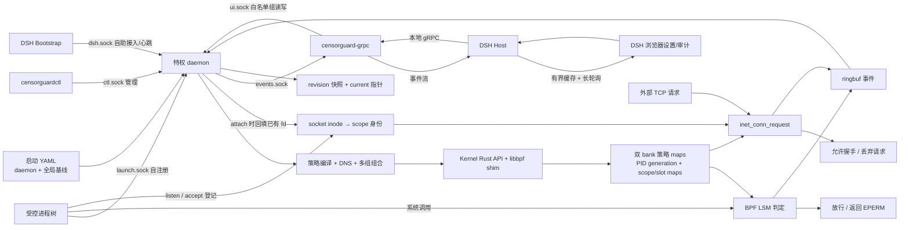

# CensorGuard 0.5.0 代码库结构与系统原理

本文依据 2026-10-12 的实际源码、构建产物及隔离实机测试编写。测试结果与修复记录见
[全流程摸底测试报告](全流程摸底测试报告.md)，部署操作见 [构建指南](构建指南.md)。

## 1. 代码库结构图

```text
CensorGuard/
├── Cargo.toml / Cargo.lock       Rust workspace、版本与锁定依赖
├── Makefile                      检查、构建、安装、打包和验收入口
├── bpf/
│   ├── enforce.bpf.c              文件/执行/网络/自保护、PID 生命周期和策略 maps
│   └── path_walk.h                非 sleepable hook 中的路径与挂载走链
├── crates/
│   ├── censorguard-common/
│   │   └── src/{abi,config,protocol}.rs       C ABI、公共配置、JSON-lines 协议
│   ├── censorguard-policy/
│   │   └── src/{compiler,net,dns,overlay,evaluator}.rs
│   │                                        规则编译、网络组合、DNS、意图预演
│   ├── censorguard-kernel/
│   │   └── src/{lib,ffi}.rs / native.c        Rust 安全接口和 libbpf C 边界
│   ├── censorguard-daemon/
│   │   └── src/{main,lifecycle,runtime,server,event,procfs}.rs
│   │                                        运行入口、进程域、事务、socket 与事件
│   ├── censorguardctl/
│   │   └── src/{main,output}.rs              CLI 与摘要/JSON/诊断输出
│   └── censorguard-grpc/
│       └── src/main.rs / build.rs            gRPC 委托适配、事件过滤、协议生成
├── api/censorguard/v1/censorguard.proto       gRPC 权威契约
├── plugins/dsh-censorguard/
│   ├── src/runtime/              自注册 RPC、心跳、保护状态机
│   ├── src/bootstrap/            Cordis 最早接入、启动闸门和重接入
│   ├── src/host/                 gRPC 桥、写权限、版本冲突、审计缓存/长轮询
│   ├── src/client/               浏览器安全设置与审计页签、控制器
│   ├── src/ui/                   UI 插件入口及可独立测试的界面模型
│   ├── cordis.patch.yml / bin/   三插件注册、依赖闸门、配置检查与 CLI 辅助
│   ├── proto/                    随包分发的契约副本，与 api/ 验证一致
│   └── test/                     审计重连、取消、写权限与版本保护回归
├── config/                       daemon/基线示例和独立 DSH 组策略
├── packaging/                    systemd、sysusers、tmpfiles
├── scripts/                      系统部署、插件安装、离线打包
├── scripts/test/                 实机与模拟验收、统一回归入口
├── tools/                        文件、网络、execveat、fork、容量和压力探针
└── docs/                         构建、使用、命令、验收与原理文档
```

`target/`、`dist/`、插件的 `dist/` 和 `lib/client.js` 是构建产物；核心源码在上述目录中。

## 2. 系统架构图



Linux LSM 执行权限判定，Rust daemon 负责装载和维护状态。DSH 或 gRPC 断线不改变
已经加载的内核规则；daemon 完整重启期间会重新加载 BPF，现有受控进程需要重新接入。
DSH Bootstrap 用心跳检测新的 boot ID 并重接入。daemon 停止后，进程持有的 BPF
对象与 link 随退出释放，保护随之停止。

## 3. 启动到停止的完整流程

1. `make all` 完成严格检查、BPF 编译、三个 Rust release 可执行文件及插件打包。
   `make setup` 在配置校验后停止旧服务，安装文件、建立账号/目录，启动服务并等待诊断通过。
2. daemon 读取启动路径的 YAML。存在 revision 快照时，恢复附加组和 domain 绑定，
   再用当前 YAML 覆盖基线及 daemon 设置；旧快照不能覆盖新启动配置。
3. 为 state 和五个 socket 获取独占锁，拒绝重复实例、正在使用的 socket 与端口冲突。
   libbpf 装载对象，挂载所有必需 hook，并安装 rename 目标检查的 tail-call 阶段。
4. 编译规则填入 bank 0，设置内核开关；启动控制、自注册、DSH、UI、事件服务，以及
   PID 对账、DNS 刷新、信号处理和可选 gRPC supervisor。gRPC 初次未就绪会让启动失败。
5. 程序通过 spawn、attach 或自注册进入 domain。BPF fork 立即继承 scope；执行系统调用
   时查当前 bank 的基线与组组合，返回允许或权限错误，同时按配置上报事件。
6. 组策略发布在运行中完成事务更新；启动 YAML 保存后需要 reload/restart。reload 校验
   新配置后完整重新执行 daemon，等待新 boot ID 与 READY；它不会启动已停止实例。
7. stop/SIGTERM 回收托管 gRPC、移除本实例创建的 socket，退出并释放 BPF 与锁。
   systemd 方式应使用 `systemctl stop`；`disable --now` 还取消开机启动。

## 4. 各模块的实现原理

### common：配置与跨语言契约

`config.rs` 用 `serde` 定义严格的 `daemon` + `rules` 格式，未知字段报错。
未配置的 enable 默认为 true，audit 与 spawn_grpc 默认为 false；示例 YAML 可显式覆盖。
`abi.rs` 固定 Rust/C 结构体布局，测试检查尺寸和对齐。`protocol.rs` 定义管理、
自注册、策略、意图及事件结构；当前协议版本为 3，兼容版本 1..3，单帧上限 64 KiB。

### policy：把规则转换成内核可查询的键

`compiler.rs` 将每行规则解析为类型明确的动作、操作掩码、目标和审计标志。
文件/目录编译为 `(dev, inode)` 与规范化路径；命令有执行文件身份及可选参数 token。
网络规则区分 IPv4/IPv6、CIDR、端口与域名，写入适合 LPM 查询的键。
组组合按规范化组名共享编译结果，文件/执行层的 deny 叠加；网络组合保留各层
端口优先与最长前缀的语义，避免一个组的 allow 绕过其它层的 deny。

`dns.rs` 经系统解析器获得 A/AAAA 地址并维护上次成功缓存。地址改变会重编译、
切换规则；解析失败且有缓存时保留旧地址并显示 stale。没有历史地址的失败解析
不能凭空生成有效 IP 拦截规则，应通过状态诊断发现。`evaluator.rs` 提供意图预演，
用于解释源规则结果；真正的系统调用判定由 BPF 执行。

### kernel：libbpf 边界、slot 与双 bank

`ffi.rs`/`native.c` 集中处理 libbpf、fd、maps、links 和 ringbuf。
`lib.rs` 用拥有资源生命周期的 Rust 类型包装这些操作，并核实必需程序全部装载。
每个 bank 有 64 个逻辑 slot：0 是基线，1..63 用于组或多组组合。相同内容可共享
inner map；多个 domain 也可绑定同一策略 slot。

热更新先准备备用 bank 的 inner maps，再写入 revision 快照，最后更新
`filter_config_map` 的 `active_bank` 和版本。current 指针持久化失败时回切旧 bank。
策略 bank 切换是单次 map 更新；随后 domain 元数据/slot 绑定仍有各自阶段，不能
宣称整个进程树、持久化和所有域在同一时刻整体切换。

### daemon：控制、事务与进程身份

`main.rs` 组织启动和后台任务；`lifecycle.rs` 管理锁、socket 所有权和同步 reload/stop。
`runtime.rs` 持有策略读写锁、串行更新锁、revision/DNS 状态和运行中的 root/domain。
附加组发布、绑定、移除与回滚由更新锁串行化；带 expected_revision 的组发布在同一锁内
检查版本并提交，避免版本检查与写入之间的竞态。启动配置与基线运行中保持不可变。

`procfs.rs` 获取所有者 UID、进程启动时间、子孙关系和 socket fd 的 inode。注册时校验 PID 的身份，回填
已经存在的子孙；内核用 generation 避免 PID 复用继承旧权限。tracked map 满载时，
fork 可进入 pending 层并继续保留 scope；退出事件和用户态 reconcile 清理条目。
根进程退出后，只要仍有受控后代，domain 保持 draining 状态。

`server.rs` 按 socket 角色及 SO_PEERCRED 双重授权：

| socket | 用途 | 授权边界 |
| --- | --- | --- |
| ctl.sock | 管理、状态、策略和生命周期 | 管理写操作要求 root/明确 gateway UID；已有 PID 操作核实所有者 |
| launch.sock | 启动前注册与自注册 | 以真实 peer PID/UID 为依据 |
| dsh.sock | attach_self/status_self/tree_self | 只能操作自身，组必须在白名单内，拒绝伪造 PID |
| ui.sock | 委托读取和组策略写 | socket 角色拒绝基线/开关/任意 PID 写，组白名单继续兜底 |
| events.sock | 只读实时事件流 | 根据 socket_group 设置访问权限；不接受客户端写协议 |

### BPF：系统调用处的实际强制

先判断对应 enable 和当前进程 scope，再按 scope 查逻辑 slot、按 active_bank 找物理规则。
未纳管进程不走这套进程树规则。文件检查覆盖 open、预打开 fd 的读写、删除、rename
两端、属性、创建及 mmap/mprotect 等；inode 与祖先目录查询之后使用路径兜底处理新建/
重建文件。走链、scratch 和目录检查有明确边界，异常时部分安全敏感路径按 fail-closed 拒绝。

执行参数在 execve/execveat tracepoint 暂存，由 bprm hook 判定。参数 map 中仅 tok[0]
非空的键标记具有参数规则的可执行文件身份，不参与规则匹配；仅该身份的参数采集失败
导致拒绝。运行时长 token 标记为不能等于短规则 token，仍检查已命中的较短拒绝前缀。
脚本多次 bprm 检查复用同一份 argv，在 exec 成功或线程退出时清理；失败 exec 的缓存
由下次入口替换。网络检查覆盖 connect、bind、显式目标发送以及已连接 socket 的
sendmsg/recvmsg；后者从 socket 读取远端地址并应用当前策略。

参数规则和审计统一为每 token 255 字节内容 + NUL，共 4 槽（可执行文件 + 3 参数）。
argument key 为 1024 字节，argv capture 使用 per-CPU map scratch，避免超过 BPF
512 字节栈限制；C/Rust 事件 args 布局同步扩大。此变更需要同步升级 daemon/BPF 并重启，
不能将新 BPF 与旧事件解析器混用。
事件为 1256 字节；C shim 接收队列按 Rust 传入的实际事件大小分配，ABI 不一致
显式报错，避免旧的 512 字节样本缓存把新事件全部丢弃。

`socket_accept` 在协议 accept 之前执行，无法读取 newsock 的远端。实际 TCP 入站检查
放在 `inet_conn_request`：listen/accept 和用户态 fd 回填维护 `socket_owners`，
握手时按监听 socket inode 找 scope，再查实时 scope→slot 绑定。拒绝请求丢弃，客户端
通常超时。已有排队/建立连接可以 accept，受控进程的后续收发仍重新授权。
`inode_free_security` 清理关闭的 socket 身份；scope 被移除后旧身份也不再用于判断。

入站 hook 可能运行在软中断，事件归属使用 socket 登记时的 scope、TGID 和 comm，
cgroup_id 置零，避免把外部客户端或当前中断线程当成服务。多进程继承同一 socket 时，
事件 PID 表示最近登记的持有者；它不是接收每个 SYN 时的实际执行线程。
`socket_owners` 上限 8192，身份登记失败时启用保护的 listen/accept 返回 ENOMEM。
不同 scope 共享同一监听 socket 会覆盖最近一次登记，当前设计应将共享监听者放在同一 scope。
这是 socket 操作/握手检查；未连接 UDP 接收、sendfile/splice 等旁路及逐包防火墙语义
不在本轮 send/recv 验证覆盖范围内。
自保护 hook 阻止受控进程对保护进程发送信号、ptrace 和使用 bpf 系统调用。

DENY 上报不依赖 audit 开关；普通 ALLOW 分别检查 audit_file/exec/net，规则 `+audit`
可要求命中时上报。ringbuf 满时事件会丢失，事件上报失败不会撤销已作出的拒绝判定。

### ctl：管理入口与诊断

`main.rs` 解析公开命令并加载连接配置，`output.rs` 输出重点状态或完整 JSON。
spawn 经父子同步在目标 exec 之前完成注册，避免“启动后再 attach”的初始执行窗口；
attach 用于已有进程，policy/bind/remove 管理附加组。status 的 Base policy 来自
daemon 实际启动路径；READY 只说明服务就绪，Managed 数量说明是否有程序接入。

### gRPC：委托适配与事件资源回收

适配器把 protobuf 请求转为 Unix JSON-lines；阻塞的管理交换放到 Tokio blocking task。
admin RPC 保留协议定义但返回 PermissionDenied；Status/GetConfig 返回六个已加载开关，
Validate/Apply 返回活跃影响域。Apply 的可选 expected_revision 传到 daemon 更新锁内。

protobuf 的 `RequestContext` 保留 origin、session/tool ID 等元数据字段，但当前 adapter
没有将其转发到 daemon 或写入 BPF 事件。实际事件关联依据 scope/domain、PID 和
policy revision；不能把这些预留字段当作已经实现的会话级持久审计链路。

每个事件订阅有自己的 Unix 连接和有界转发队列，按 domain/kind/allowed 过滤。
订阅对象 Drop 时 shutdown socket，唤醒阻塞 reader；daemon 也检测空闲断开并解除订阅。
“委托角色”描述协议权限：当前由 root daemon 派生时，适配器继承其 UID，并没有单独
执行降权。限制由 adapter 检查和 daemon ui.sock 角色 ACL 实现。默认仅监听 loopback，
协议本身没有网络身份认证，部署时应据此安排监听范围。

### DSH 插件：接入、状态与界面

runtime 负责自助 RPC 和心跳；bootstrap 在关键 Cordis 入口之前建立整树保护，提供
`censorguardReady`。默认接入失败进入 degraded 并后台重试，DSH 仍可使用；配置
blockOnFailure 时启动闸门要求成功接入。dispose 关闭连接/定时器，不自动解除保护。

host 用本地 gRPC 读策略和事件，对管理写请求检查 loopback 来源与当前绑定组。
编辑器携带版本，桥接到实际提交时仍校验；冲突提示重新读取。审计缓存有条数/字节上限，
长轮询随浏览器取消立即释放，boot ID 改变时重置 sequence 游标。
client 注册到 DSH 原生设置 slot 和审计页签，与原生对话、轨迹、工作区和侧栏共同工作。

### packaging/scripts：可重复部署与验证

systemd unit 使用固定启动配置、信号重载及整个 cgroup 的进程管理；sysusers/tmpfiles
准备账号和目录。unit 的 `CAP_SYS_PTRACE` 用于跨 UID 读取 `/proc/<pid>/fd`，
不是向客户端开放 ptrace 权限；SO_PEERCRED 与管理写 ACL 继续约束调用者。
安装保留已有 YAML，离线包用 `.yaml.example` 避免覆盖配置。
插件安装器处理同版本重装和旧多包依赖迁移。统一回归入口发现 Shell/Python 测试，
按选项包含 gRPC、DSH 发布安装及真实浏览器测试，输出每项日志和 JSONL 结果。

## 5. 审计与保护的边界

事件是实时观察窗口，daemon/adapter/Host 都存在有界缓冲和断线窗口；sequence、
boot ID、dropped_before 与缓存淘汰信息帮助呈现缺口，不构成持久审计归档。
压力测试证明本机指定场景下的行为，不证明所有内核版本、所有系统调用和任意负载均无缺陷。
微秒级延迟、真实外部模型服务、跨发行版兼容性与断电持久化恢复需要各自独立实验。
