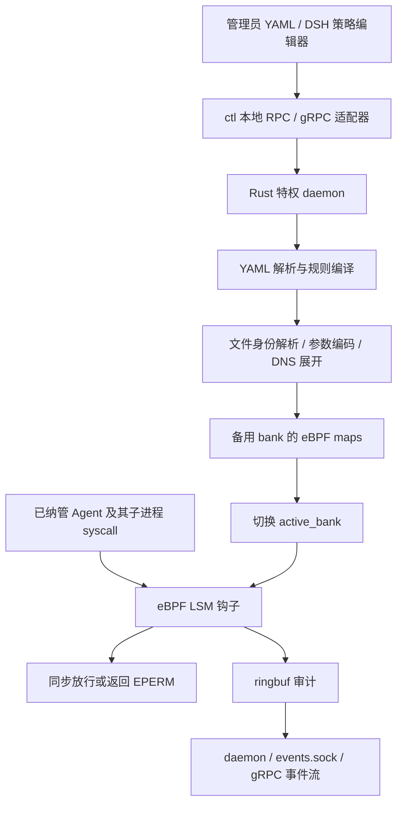
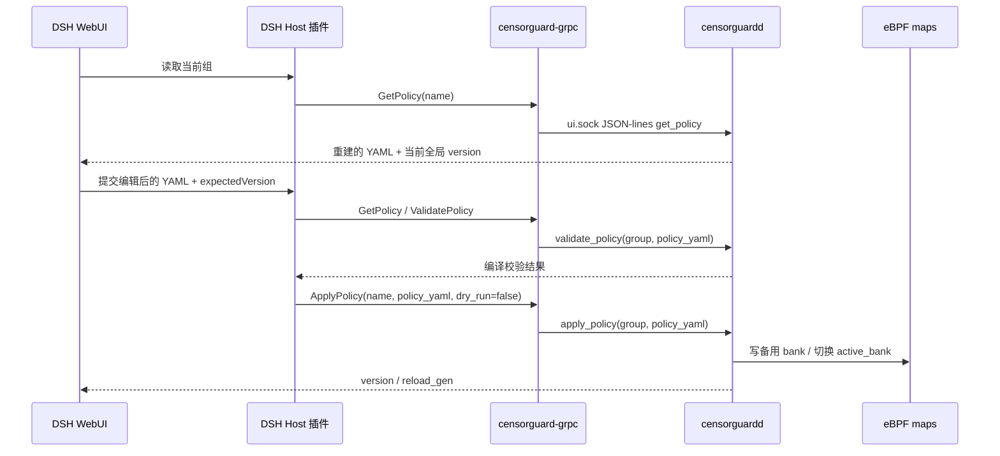

# CensorGuard 策略下发、热更新与实时拦截审查

审查日期：2026-10-08。对象：当前仓库源码，workspace 版本 0.4.0。
本文区分设计流程、当前代码行为和已发现的问题，供技术沟通使用。
本次没有修改业务代码，没有加载 eBPF 或运行会改变主机安全钩子的集成测试。

> 2026-10-09 更新：本文保留 10 月 8 日审查时的行为与命令。当前版本已改为
> `launch` 加载/恢复策略、`policy apply` 更新组、`bind` 发布 domain 绑定、
> `attach` 自动回填子孙；静态网络规则的 DNS 保留与 exec/network 的基线叠加已修正。
> 当前规范见 [命令手册](命令手册.md)，本文的历史命令不作为现行接口。

## 1. 审查发现

### P1：静态网络规则在 DNS 展开时丢失，已最小复现

`compile_unified_rule()` 把 IP/CIDR 规则写入 `network`、`network_ports`、
`network6`、`network6_ports`，却没有写入对应的四个 `*_static` 集合。
`dns::apply_cache()` 随后用这些空的静态集合覆盖网络集合。
daemon 启动和热更新都会调用 `resolve_dns()`，即使策略没有域名规则也会覆盖。
结果是静态 IP/CIDR/端口规则无法按预期进入生效 bank，尤其影响网络黑名单和默认拒绝网段。

位置：`crates/censorguard-policy/src/compiler.rs:464`、
`crates/censorguard-policy/src/dns.rs:79`、`crates/censorguard-daemon/src/main.rs:76`。
最小复现为四条静态 IPv4/IPv6、带端口/不带端口规则，结果：

```text
before DNS: ipv4=1 ipv4_port=1 ipv6=1 ipv6_port=1
after DNS:  ipv4=0 ipv4_port=0 ipv6=0 ipv6_port=0
```

建议：编译时保存静态集合，并覆盖“编译 → DNS 展开 → 内核安装输入”的回归测试。

### P1：委托控制面可被本机 Agent 直接调用

`ui.sock` 权限是 0666，角色允许白名单组写入和 `SetSwitches`；后者明确允许
任意 Ui 角色 peer 修改全局 `enable_file/exec/net`。gRPC 默认监听本机 TCP，
没有调用者认证，也暴露相同接口。Agent 可以绕过 WebUI 的来源检查，直接提交空规则组
或关闭全局拦截开关。文件策略禁止写 `/run/censorguard` 并不能阻止 Unix socket RPC。

systemd 的 `/run/censorguard` 是 0750，这限制了直接访问 socket 的用户；
但文档要求 DSH 用户加入该组，且本机 TCP gRPC 仍没有相应用户认证。

位置：`crates/censorguard-daemon/src/server.rs:122`、`:756`，
`crates/censorguard-grpc/src/main.rs:267`、`:518`。
建议：把策略写入和开关控制交给独立可信身份，避免受保护 Agent 获得同等控制权限。

### P1：仓库 systemd 启动方式不会恢复已下发策略

systemd 使用 `censorguardd launch`。该模式将 `policy_free` 置为 true，
启动分支直接编译 `rules: []`，没有读取持久化的 `current`。
`Runtime::new()` 又把空策略写成 revision 1，并把 `current` 更新为 1。
因此重启后需要重新下发策略，DSH 的原策略组也会缺失，不能承诺“持久化即自动恢复”。
非 launch 模式只有在配置文件存在时才调用 `load_startup_policy()` 恢复快照。

位置：`packaging/systemd/censorguardd.service:18`、
`crates/censorguard-daemon/src/main.rs:65`、`:365`，
`crates/censorguard-daemon/src/runtime.rs:251`。
建议：启动优先恢复当前已提交快照，空策略只用于首次初始化；补充服务重启验收。

### P2：策略内容切换与域绑定切换不是同一事务

`apply_policy_locked()` 先激活新 bank、写入 current 和用户态策略，再调用
`refresh_domain_metadata()` 逐域更新 `scope_policies`。
如果完整 reload 同时改变域到组的绑定，内核可能短暂使用“新 bank + 旧组 slot”。
删除旧组并复用 slot 时可能命中另一个新组。域绑定更新失败还会在策略已经生效后返回错误，
该阶段没有回滚。因此“失败一定保留旧策略”“所有内容和绑定完全原子”都过于宽泛。

位置：`crates/censorguard-daemon/src/runtime.rs:1082`、`:1112`、`:1256`，
`crates/censorguard-kernel/src/lib.rs:140`。
建议：域绑定也纳入 bank，或设计统一提交点，并测试并发 syscall、绑定改变和失败注入。

### P2：WebUI 版本校验存在并发覆盖窗口

Host 先 `GetPolicy` 比较 `expectedVersion`，随后分别 `ValidatePolicy` 和 `ApplyPolicy`。
proto 的 ApplyPolicy 没有 expected revision 字段，适配器也没有传递 revision。
两个客户端可以都通过前置校验后依次覆盖。daemon 完整策略 RPC 的版本检查在
`reload_lock` 内，但 gRPC 组写入没有使用该能力。

位置：`plugins/dsh-censorguard/src/host/hostCore.ts:107`、
`api/censorguard/v1/censorguard.proto:135`、
`crates/censorguard-grpc/src/main.rs:409`。
建议：把预期版本随 ApplyPolicy 传到 daemon，并在更新锁内检查。

### P2：部分 gRPC 契约字段尚未兑现

Validate/Apply 的 `affected` 始终返回空；dry-run 的版本与代数返回 0。
请求里的 `RequestContext` 没有被适配器映射到 daemon 请求，不能据此承诺完整来源审计。
GetPolicy 的 YAML 是结构重新序列化结果，不保留原文件注释、排版；version 是全局策略版本，
不是每个组独立计数。

位置：`crates/censorguard-grpc/src/main.rs:336`、`:377`，
`crates/censorguard-daemon/src/runtime.rs:528`。

## 2. 客户可理解的整体架构



策略控制在用户态，安全决定在内核态。每次 syscall 不需要通过 gRPC 查询权限。
当前仓库没有远端策略中心、配置订阅流、YAML 文件监听或自动下载策略的代码。
“下发”是调用方主动提交策略，“热更新”是 daemon 收到请求后替换运行中的 maps。

## 3. 策略下发：从 YAML 到内核规则

### 3.1 支持两种文档

完整文档通过 `PolicyRoot` 解析，包含全局基线、命名组和域绑定：

```yaml
rules:
  - file deny+audit /etc/shadow
groups:
  customer-agent:
    rules:
      - exec deny /usr/bin/nc
      - file deny /srv/customer/secret
domains:
  - name: customer-session
    group: customer-agent
```

仅替换一个组时，通过 `GroupPolicy` 解析，只接受 `rules`：

```yaml
rules:
  - exec deny /usr/bin/nc
  - file deny+audit /srv/customer/secret
```

`rules` 是所有纳管域的基线，不代表拦截主机全部进程。
域只是进程树的逻辑隔离名称；组是域绑定的规则集合，多个域可以共享组。

### 3.2 YAML 解析和规则编译

1. `load(path)` 用 `fs::read` 读取字节；`compile_yaml(bytes)` 调用
   `serde_yaml::from_slice::<PolicyRoot>()`，得到 Rust 类型结构。
2. schema 使用 `deny_unknown_fields`。未知字段、重复域、非法名称、缺失组引用等返回错误。
   `enable_*`/`audit_*` 不是 YAML 字段，而是另外的运行时控制接口。
3. `compile_group()` 遍历规则字符串，`compile_unified_rule()` 按空白切词，解析
   `file|exec|net`、`allow|deny[+audit]`、目标和可选操作掩码。
4. 文件规则编译成路径键和 `(dev, ino)` 键；目录额外进入目录 inode 集合。
   文件暂不存在时保留路径规则并生成 warning。路径与 inode 双身份用于降低别名、重建等绕过风险。
5. exec 规则编译成可执行文件路径、inode 和参数前缀键。参数匹配最多 4 个 token，
   含程序自身；普通 token 最多 255 字节。它不是 shell 语法、正则或通配符解析器。
6. 网络规则解析 IPv4/IPv6、CIDR、可选端口或域名。域名保留到用户态 DNS 展开阶段。
7. 编译结果为 `CompiledPolicy/CompiledRules`，保存规则原始字符串和 10 类内核规则集合。

入口：`crates/censorguard-policy/src/config.rs:5`、
`crates/censorguard-policy/src/compiler.rs:173`、`:182`、`:400`。

### 3.3 管理员下发通道

```bash
# 完整策略：发送文件路径，由 daemon 在本机读取
sudo censorguardctl reload --file /absolute/path/customer.yaml

# 单组替换：ctl 读取文件，将 YAML 内容放进请求
sudo censorguardctl reload --policy customer-agent --file group.yaml

# 将实际进程纳管到策略文档定义的域
sudo censorguardctl attach --pid PID --domain customer-session --seed
```

ctl 用 `UnixStream` 连接 `ctl.sock`，发送 JSON 一行，读取 JSON 一行回执。
`reload --file` 的路径相对于 daemon 环境解释；它不是上传文件。
`policy apply --file` 则在客户端读文件并提交 `policy_yaml` 字符串。
daemon 依据 socket 角色和 `SO_PEERCRED` 中的真实 uid/pid 校验操作权限。
组替换先解析片段，再合并到当前完整文档，重新编译完整策略。

入口：`crates/censorguardctl/src/main.rs:223`、`:287`，
`crates/censorguard-daemon/src/server.rs:1006`。

## 4. 热更新：如何获取策略并通过 gRPC 通信

### 4.1 DSH 获取和提交策略



Host 用 `@grpc/grpc-js` 和 `@grpc/proto-loader` 动态加载随包分发的 proto，
建立本机 gRPC client。默认地址 `127.0.0.1:50051`，使用 `createInsecure()`。
Rust 适配器使用 tonic/prost；每次 RPC 转成带 `version/request_id/method/params` 的
`RpcRequest`，单独连接 `ui.sock`，设置 30 秒读写超时，并把 daemon 错误转成 gRPC status。
YAML 作为 protobuf 的字符串字段传输，不是在通信过程中解析成内核规则。

真正解析仍在 daemon；适配器只做转换和入口限制，禁止修改 `__base__`。
daemon 再检查目标组是否属于 `--dsh-self-groups` 白名单。
Track/Untrack/绑定/全局配置等管理 RPC 虽保留在 proto 中，但 gRPC 实现返回权限拒绝。

入口：`plugins/dsh-censorguard/src/host/grpc.ts:180`、
`plugins/dsh-censorguard/src/host/hostCore.ts:99`，
`crates/censorguard-grpc/src/main.rs:49`、`:377`，
`crates/censorguard-daemon/src/server.rs:634`。

### 4.2 daemon 双 bank 更新步骤

1. 获取 `reload_lock`，串行执行 reload、绑定和开关更新。
2. 编译新策略并展开 DNS；校验活跃域引用、规则组容量和下一版本。
3. 保留现有组的逻辑 slot，规划下一 bank：`next_bank = active_bank ^ 1`。
4. `prepare_policy_bank()` 写备用 bank。每 bank 有 64 个 slot：0 是基线，
   1..63 是组 slot；多个域可共享组，不能把这个限制解释成最多 63 个域。
5. C/libbpf shim 为每一维创建新 inner map、逐条写入，再用 fd 更新 outer map 的槽位。
   10 维包括文件路径、文件 inode、目录 inode、命令路径、命令 inode、参数、
   IPv4 地址、IPv4 端口、IPv6 地址、IPv6 端口。相同内容可共享 inner map。
6. 把新策略快照写入 `revisions/<version>.yaml`，通过临时文件、fsync、rename 持久化。
7. `activate_policy()` 更新 `filter_config_map[0]`，选择新 active bank，保留运行时开关。
8. 持久化 `current`。这一步失败时尝试切回旧 bank；再更新用户态状态及各域绑定。
9. 返回 version、reload_gen 等回执。`dry_run` 在实际写 bank 前返回，不增加版本。

编译、备用 bank 构建、快照写入失败时，旧 bank 继续提供拦截。
但第 8 步后的绑定失败及跨 bank/绑定的一致性问题见审查发现，不能扩大原子性承诺。
当前 dry-run 不实际创建 inner maps，因此不能替代容量/内核安装成功验收。

入口：`crates/censorguard-daemon/src/runtime.rs:922`、`:1033`，
`crates/censorguard-kernel/src/lib.rs:273`、`:315`，
`crates/censorguard-kernel/src/native.c:291`。

### 4.3 其他更新触发

- `reload --stdin`：直接提交完整 YAML 内容；`policy apply --policy ... --stdin`：提交单组片段。
- `SIGHUP`：重新读 daemon 的 `config_path`；仅修改文件不会自动触发 reload。
  某次 `reload --file X` 不会将 X 改为后续默认配置路径。
- DNS 线程默认每 60 秒重新编译当前策略、调用系统解析器取得 A/AAAA 地址。
  地址变化时走相同的 bank 更新逻辑；无变化不提交新版本。这个周期不是策略中心拉取周期。
- DNS 失败时沿用内存中已有地址并标记 stale；首次失败且无缓存则没有对应 IP 规则。
  不能把域名规则描述成 DNS 故障下仍一定有效，也不是按 DNS TTL 精确刷新。

## 5. 实时拦截：纳管进程如何命中规则

### 5.1 进程树纳管

管理员 Track/Attach 或 DSH Bootstrap `attach_self` 注册进程树根。
DSH 自附着的 pid 来自 `SO_PEERCRED`，不能由客户端伪造。
daemon 写 `tracked_pids[tgid] = scope_id` 和 `scope_policies[scope_id] = policy_slot`。
fork tracepoint 在内核立即继承 scope；主追踪表写入失败时尝试 pending 表，
所有拦截钩子都能读取 pending scope。PID 启动时间用于防止 PID 复用继承旧身份；退出时清理。
已有子进程可通过 seed 扫描纳管。两张表都写失败时仍需关注覆盖丢失，不能承诺无限进程容量。

入口：`crates/censorguard-daemon/src/runtime.rs:388`，`bpf/enforce.bpf.c:470`、`:2790`。

### 5.2 每次安全检查的判定路径

```text
syscall → LSM hook → enable 开关 → tgid / 启动时间 → scope_id
        → scope_policies 的 logical slot
        → active_bank * 64 + logical slot
        → 基线与组的 inner map 查找 → 放行 0 / 拒绝 -1 (EPERM)
```

未纳管进程不受这些规则约束；关闭某一 enable 开关时该维度放行。
热更新不重启 Agent，也不重新加载 BPF 程序；后续检查查当前 map。
它不会撤销已经完成的操作、关闭已有连接或恢复已写入数据。

| 类型 | 关键钩子 | 实际判定 |
| --- | --- | --- |
| 文件 | file_open、file_permission、truncate、unlink、rename、chmod/chown、xattr/ACL、mmap/mprotect 等 | inode、祖先目录规则及部分钩子的路径兜底；按 read/write/delete/rename/attr 拒绝掩码判断 |
| 执行 | sys_enter_execve/execveat + bprm_check_security | tracepoint 提前保存参数，LSM 对实际可执行 inode/路径与参数前缀检查并拒绝 |
| 网络 | socket_connect | IPv4/IPv6、目标 IP/CIDR 与端口，通过 LPM trie 匹配；不是 HTTP URL/请求内容检查 |
| 自保护 | task_kill、ptrace、bpf | 限制受控进程针对保护进程或 BPF 控制面的相关操作 |

文件/exec 的 deny 会叠加，allow 不能用来取消已有 deny。
网络先查带端口规则，再查地址规则；同一层基线或域命中 deny 时拒绝，LPM 选择最长前缀。
因此不能把所有类型简化成“后写规则覆盖前写规则”或统一的 allow 优先。
网络目前只挂 socket_connect，不覆盖所有 sendto/sendmsg、已建立连接上的每次发送或 L7 内容。

入口：`bpf/enforce.bpf.c:1261`、`:1754`、`:2332`、`:2556`。

## 6. 实时审计与策略通信是两条通路

内核在判定点尝试写 ringbuf；拒绝决定不依赖审计消费完成。
DENY 尝试记录，ALLOW 依据规则 `+audit` 和全局 audit 开关决定，部分高频文件钩子省略 ALLOW。
ringbuf 满等情况可丢事件，所以“DENY 永远记录”不能解释为日志绝不丢失。

daemon 将内核事件转成 JSON，补充域名、sequence、daemon_boot_id；每个订阅者使用有界队列，
并以 dropped_before 报告该订阅者队列的累计丢失。内核及 reader 丢失另有统计。
适配器的 `SubscribeEvents` 从 events.sock 读取，按 domain/kind/allowed 过滤后走 gRPC 服务端流。
DSH Host 缓存，Client 长轮询；策略 ApplyPolicy 本身是一次请求回执，不是策略流订阅。
事件不提供持久化回放；sequence gap 也可能来自过滤，不能单凭 gap 推断所有丢失原因。

入口：`crates/censorguard-daemon/src/event.rs:94`，
`crates/censorguard-grpc/src/main.rs:429`。

## 7. 可用于客户沟通的表述

> CensorGuard 在用户态接收并编译 YAML 策略，支持管理员本地下发以及 DSH 插件经本机
> gRPC 提交策略组变更。规则安装到 eBPF maps，通过备用 bank 构建和 active bank 切换实现
> 运行中更新。Agent 进程树纳管后，Linux LSM 在文件访问、程序执行和建立网络连接的关键点
> 同步查规则并拒绝违规操作，审计事件异步输出。

与客户确认的交付边界：远程策略中心接入尚需实现；调用者身份隔离、静态网络规则、重启恢复、
绑定事务和并发版本控制需先修复或验收；参数规则不是任意命令语义分析，网络规则也不是 L7 防火墙。

## 8. 验证记录

- `cargo test --workspace --offline`：53 项测试通过，gRPC crate 当前没有单元测试。
- 单独的最小程序调用 `compile_yaml → resolve_dns`，已复现四类静态网络规则全部变空。
- 未运行 root/eBPF 集成测试；本文不把 README 的历史测试记录当作本次实机验收。
- 未修改业务实现；最小复现程序位于 `/tmp/censorguard-review-probe.rs`。
