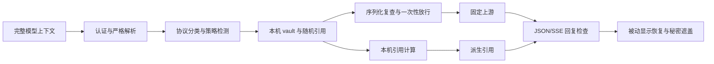

# CensorPrivate 架构

CensorPrivate 是 AgentCensor 的模型数据隐私子项目。CensorFS 管理文件工作区，CensorGuard 管理内核执行与访问边界，CensorScope 管理运行观测，CensorPivot 编排批次；CensorPrivate 负责模型请求保护、授权显示及引用计算。当前项目可独立运行，没有将自身隐式注册为其他组件的服务，也不要求修改 DSH 源码。

## 目录与职责

| 位置 | 职责 |
| --- | --- |
| `src/policy.rs`、`detection.rs` | 不可变策略、规则与本机检测器、UTF-8 范围检查、重叠合并 |
| `src/references.rs`、`vault.rs`、`compute.rs` | 随机引用、run 授权、内存原值、期限/标签继承、精确计算 |
| `src/json.rs`、`protocols.rs`、`gate.rs` | 有界严格解析、协议字段分类、完整请求保护、一次性放行 |
| `src/display.rs`、`response.rs`、`streaming.rs` | 被动显示恢复、SECRET 遮盖、JSON/SSE 回复处理 |
| `src/server.rs`、`main.rs` | 认证、固定 HTTP/HTTPS 上游、重载与状态文件 |
| `src/mcp.rs`、`src/bin/` | 私密工具客户端、stdio MCP、五个命令入口 |
| `src/tls_privacy.rs`、`tls_broker.rs`、`native/` | 等长映射、broker 决策、动态 OpenSSL ABI hook |
| `src/runtime/`、`crates/runtime-sys/` | Linux namespace、挂载、降权、seccomp 与必要 syscall |
| `plugins/dsh-censorprivacy/` | DSH 模型适配与精确命名的 `private_compute` 工具 |
| `scripts/ops/`、`deploy/`、`docs/` | 环境检查、安装、生命周期、演示、部署和使用说明 |
| `tests/` | 单元/集成测试、207 组固定样例、真实 native 与隔离验收 |

## 引用与授权

CP 引用是随机对象标识，不是密文或授权凭据。原值只保存在本机 run vault；引用语法正确、知道 run ID 均不能获取读取权限。只有 `begin_run` 能构造私有字段的 `RunCapability`，访问还检查 vault 身份、所有者、run、epoch、单调时钟 TTL 和依赖。

SECRET 不能恢复或计算。私密计算只接受授权引用，内部采用有界精确十进制与日期运算，结果仍是继承标签、期限和依赖的引用。表达式身份使 min/max 结果不能通过引用相等暴露获胜输入。非终止除法、混合单位、过大数值和未知操作拒绝处理。

核心 crate 使用 `#![forbid(unsafe_code)]`，FFI 集中在最小系统边界。vault 敏感字符串和运行配置释放时清零；此措施不保证所有 JSON 临时副本、第三方大整数 limb、分配器或操作系统内存均被清除。

## 网关链路

模型、角色、URL、工具名等结构字段不得任意改写。业务数字和协议控制数字按位置分类。放行凭据绑定目标、方法、请求字节、run 和 epoch，不能重复消费。异常只返回稳定错误码，不输出输入或上游错误正文。

只有被动显示位置可以恢复。代码、URL、Markdown 活动目标、普通工具参数与未知通道不获得显示授权。SSE 任意分片不能改变规则；未知格式与失败均拒绝，无原文回退。

## TLS 与运行域

TLS direct 保持客户端原连接，hook 在加密前暂存完整请求，broker 只返回 `DEFER`、`BLOCK` 或完整等长 `REPLACE`。JSON 解码字符映射到原始 UTF-8/转义/代理对字节；别名与填充保持 wire 长度。重试仅复用已批准缓冲及偏移，绝不恢复发送原文。支持范围是动态 OpenSSL、固定 IPv4 peer、HTTP/1.1、Content-Length、非流式未压缩 JSON。

网关只保护发到其入口的请求。`privacy-run` 另建网络、挂载、PID/IPC、权限与 seccomp 边界，约束后代绕行。工作区必须专属，额外运行依赖显式批准。namespace 身份或人口无法确认时保留保护规则。`tls-run` 是协作接入，不替代强制隔离。

部署见 [构建教程](build-and-deploy.md)，日常使用与 DSH 见 [使用手册](usage.md)，可重复验证见 [验收记录](validation.md)。
